<div align="center">

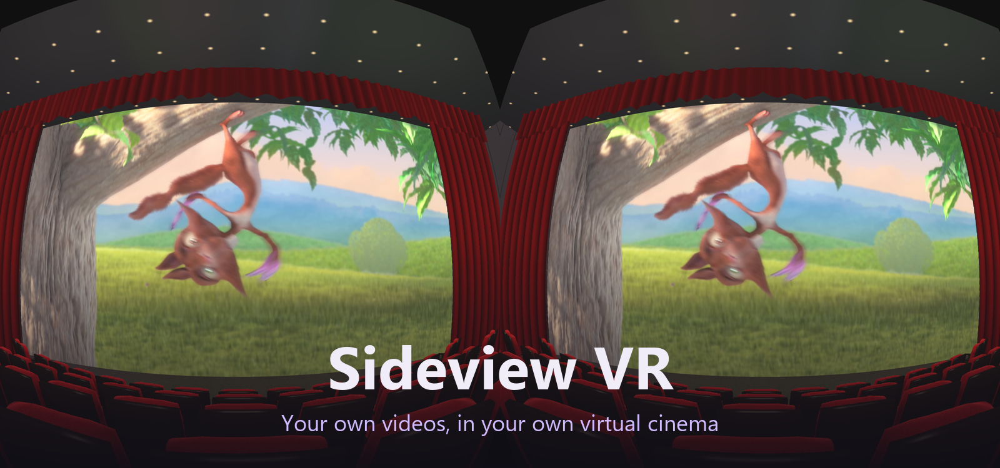

# Sideview VR

**Your own videos, on a giant screen, in your own virtual cinema.**

Sideview VR is an open-source Android VR video player for phone headsets (Cardboard and Daydream style).<br>
It puts your movies and shows on a big screen in a theatre with stadium seating, curtains and dimming lights,<br>
and plays almost any file thanks to libmpv.

[](https://github.com/Echosky/sideview-vr/actions/workflows/ci.yml)
[](LICENSE)


[Beta status](#beta-status) · [Screenshots](#screenshots) · [Features](#features) · [Install](#installation) · [Controls](#controls) · [Build](#building-from-source) · [FAQ](#faq)

</div>

---

## Beta status

> [!WARNING]
> **Beta software.** Sideview VR has been tested on one phone so far: a **ZTE Axon 7** (Snapdragon 820,
> LineageOS 17.1 / Android 10) in a Daydream View headset. It needs more testing and evaluation on
> other Android phones and headsets. Bug reports with your phone model are very welcome.

## Why Sideview VR

You have a phone, a cheap VR headset in a drawer, and a library of videos on a NAS or SD card. You want
to watch them on a cinema-sized screen, on a plane or in bed, without accounts, ads or a streaming service.

- **A real theatre, not a black void.** Curved stadium rows of padded seats, velvet curtains, house lights
  that dim when the movie starts, and a room lit by the picture.
- **Plays your files.** libmpv decodes nearly everything: MKV, MP4, HEVC/AV1, 10-bit, HDR (tone-mapped),
  3D side-by-side/top-bottom, 180° and 360° video.
- **Your library, your network.** SMB shares (also over a VPN), DLNA servers and local files, plus offline
  copies of whole series for trips.
- **Free software.** GPL-3.0-or-later, no tracking, no network calls except to the servers you add.

## Screenshots

All screenshots are taken on the Axon 7 in headset (stereo) mode, playing *Big Buck Bunny*.

<table>
<tr>
<td align="center" valign="top">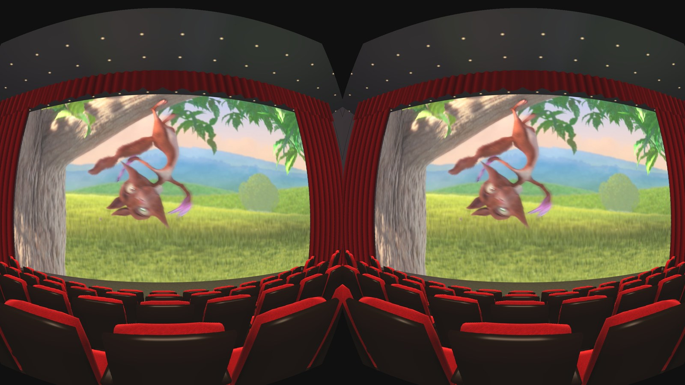<br><b>The theatre</b><br>Curtains, stadium seats, 11 m screen</td>
<td align="center" valign="top">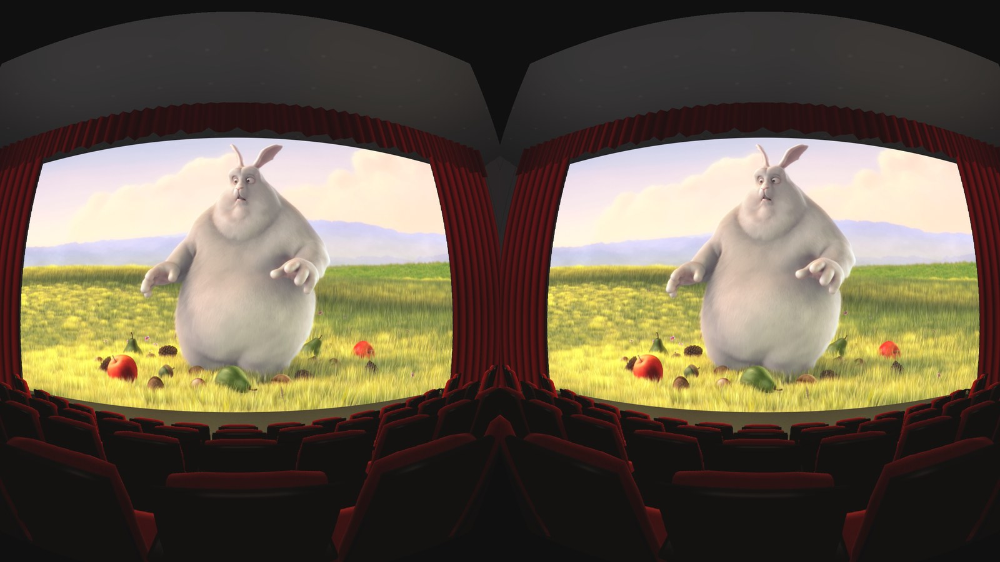<br><b>Lights down</b><br>Dims a few seconds after the movie starts</td>
</tr>
<tr>
<td align="center" valign="top">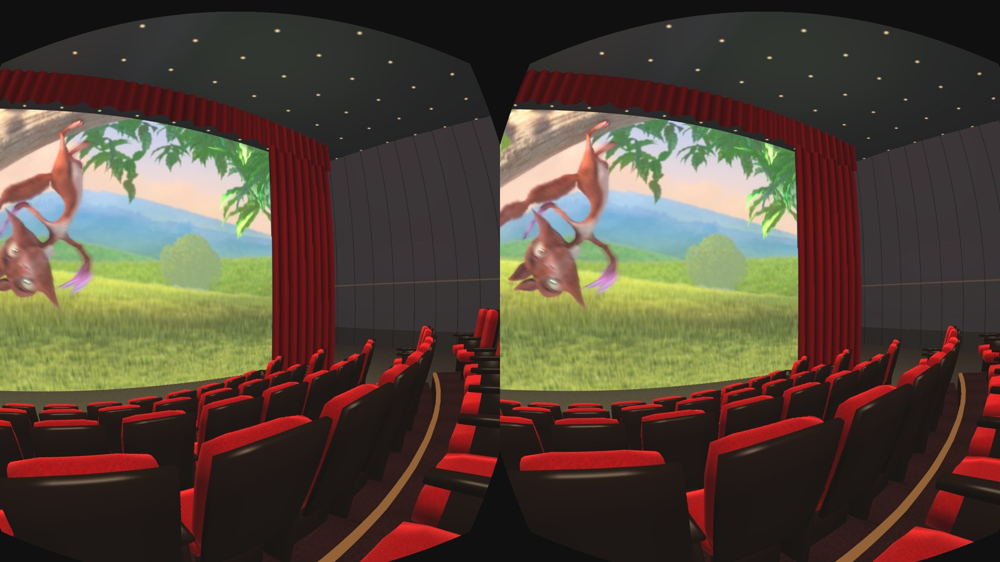<br><b>Look around</b><br>Velvet curtains and curved rows</td>
<td align="center" valign="top">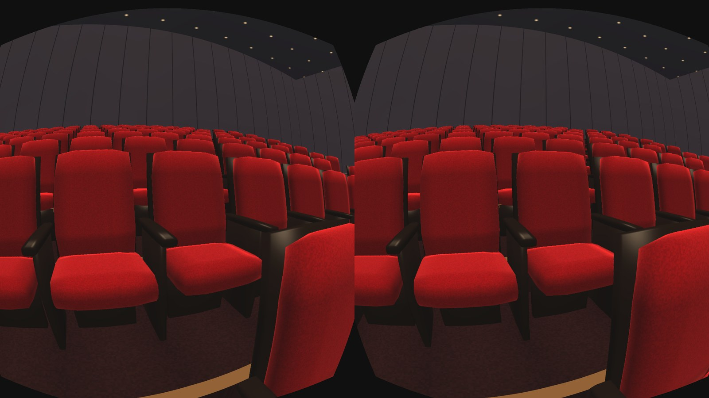<br><b>Stadium seating</b><br>Rows rise behind you</td>
</tr>
<tr>
<td align="center" valign="top">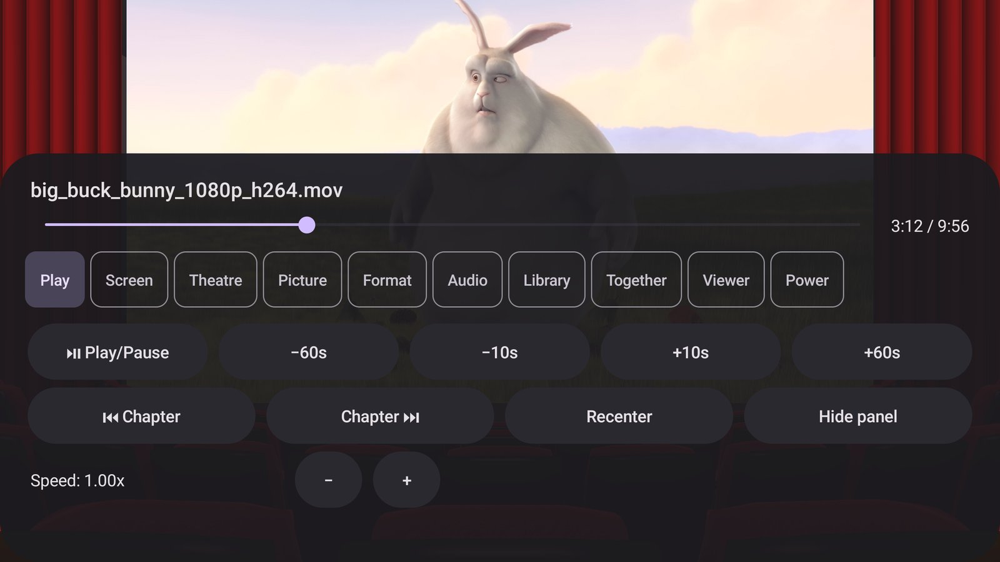<br><b>Menu</b><br>Same panel in the headset (point to use) and on the phone</td>
<td align="center" valign="top">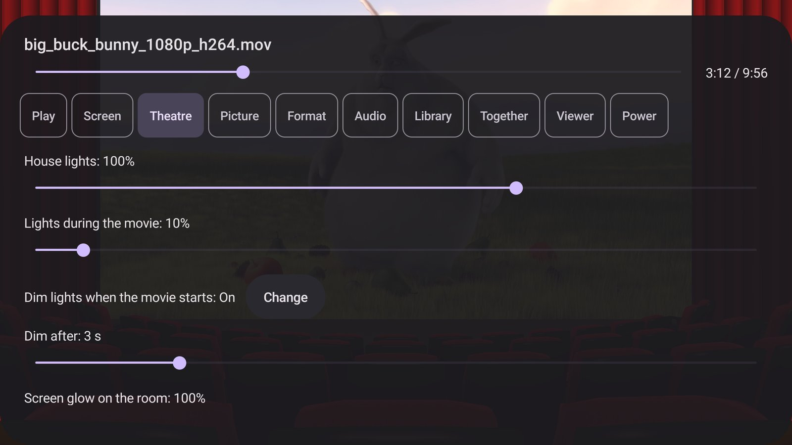<br><b>Theatre settings</b><br>Light levels, dim delay, seats, curtains</td>
</tr>
<tr>
<td align="center" valign="top">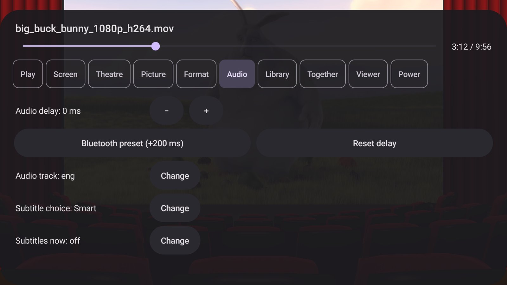<br><b>Smart audio and subtitles</b><br>Pick your language from a list</td>
<td align="center" valign="top">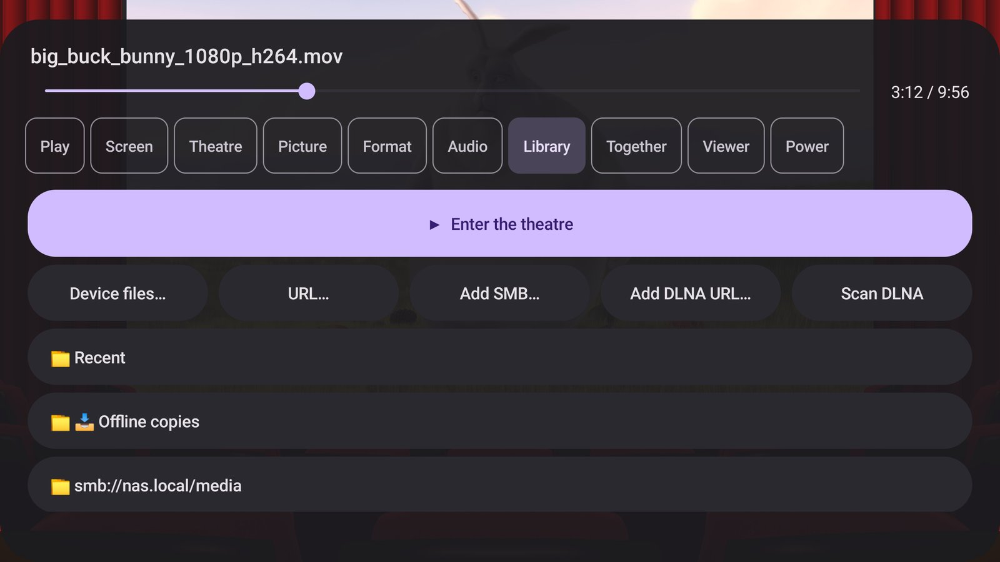<br><b>Library</b><br>SMB, DLNA, recents, offline copies</td>
</tr>
<tr>
<td align="center" valign="top">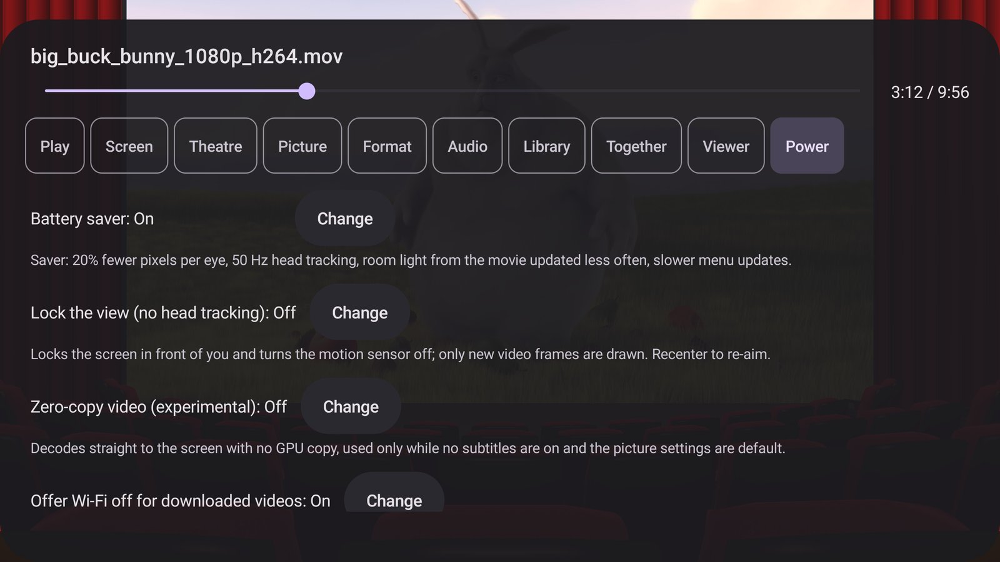<br><b>Battery</b><br>Saver, view lock, zero-copy video</td>
<td align="center" valign="top">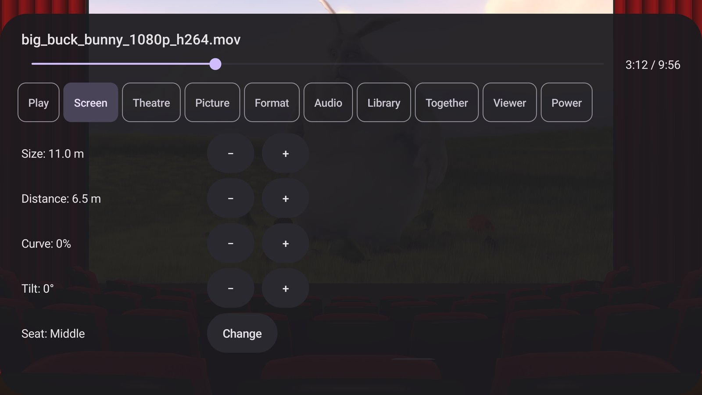<br><b>Screen</b><br>Size, distance, curve, tilt, seat, smart view</td>
</tr>
<tr>
<td align="center" valign="top">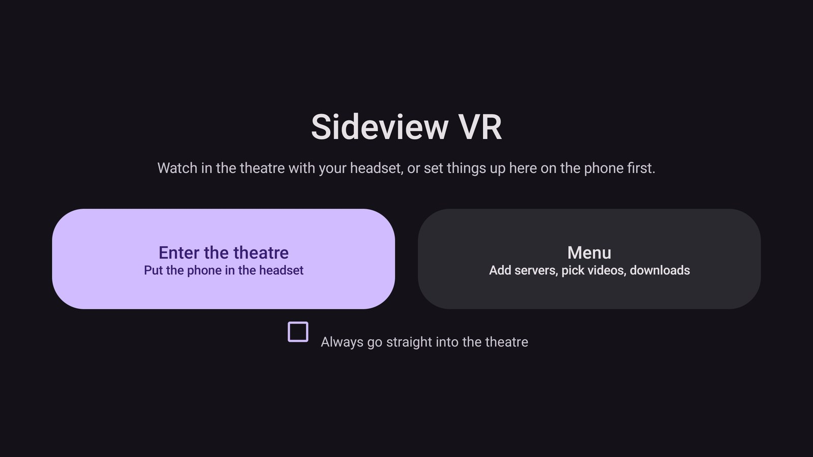<br><b>Start screen</b><br>Theatre straight away, or the phone menu</td>
<td align="center" valign="top">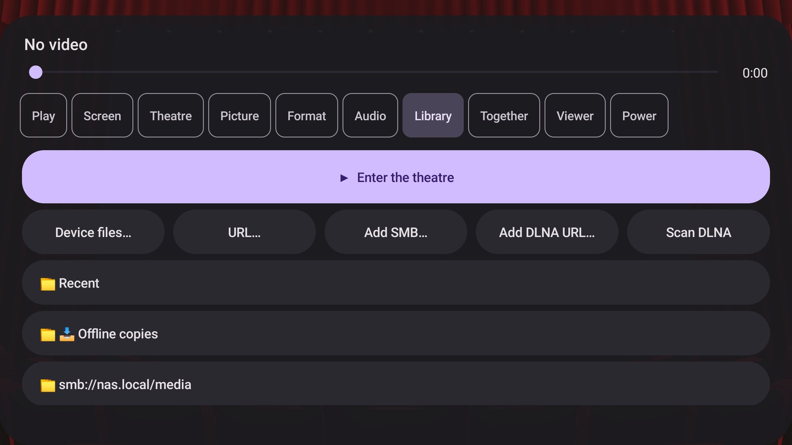<br><b>Phone menu</b><br>Set up servers without a VR keyboard</td>
</tr>
</table>

## Features

<table>
<tr>
<td width="50%" valign="top">

### 🎬 The theatre
- Stadium seating: curved rows stepping down to the screen, step lights
- Velvet curtains and valance, room lit by the movie
- House lights with exact sliders; dim 0–15 s after the movie starts
- Point at the lights and scroll to dim them
- Point at the screen and scroll to resize it; click it to play/pause
- Screen size, distance, curve, tilt; front, middle or back seat

</td>
<td width="50%" valign="top">

### 📼 Formats
- Everything libmpv plays: MKV, MP4, AVI, TS, WebM, HEVC, AV1, VP9…
- Hardware decoding (MediaCodec), HDR10/HLG tone-mapped to SDR
- 3D side-by-side and top-bottom (half/full), swap eyes, depth
- 180°, 360°, fisheye, EAC (experimental); detected from file names
- Blu-ray ISO (unencrypted, no menus), chapters, speed control

</td>
</tr>
<tr>
<td valign="top">

### 🗂️ Your media
- Local files and "Open with" from any file manager
- SMB2/3 shares, e.g. a home NAS, also over a VPN
- DLNA/UPnP servers (scan or add by URL), URLs
- Recents with resume position
- Offline copies: a file, a folder or a whole series, resumable
- Offline copies play first, with a hint to turn Wi-Fi off

</td>
<td valign="top">

### 💬 Smart audio and subtitles
- Choose your language from a scrollable list
- Audio already in your language: only "forced" subtitles
  (foreign dialogue), never full ones
- Foreign audio: full subtitles, plain before SDH, never commentary
- Dual-audio files that default to a dub switch to your language
- Finds subtitle files next to videos on SMB shares

</td>
</tr>
<tr>
<td valign="top">

### 🎮 Controls
- Daydream controller over Bluetooth LE (pointer, touchpad, buttons)
- Bluetooth mouse: point, click, right-click for the menu, wheel
- Head gaze and the headset button; keyboards and gamepads
- Smart view adjust: the screen eases to where your head rests

</td>
<td valign="top">

### 🔋 Battery
- Frames are drawn only when your head moves or a new frame arrives
  (about 24–27 fps instead of 60 while you sit still)
- Battery saver, view lock (motion sensor off)
- Zero-copy decoding when no subtitles are shown
- Network video buffered in large bursts so Wi-Fi can sleep

</td>
</tr>
</table>

Also: Bluetooth audio delay presets, picture controls, watch together (synced playback between
phones), viewer profiles for Cardboard v2 and Daydream View plus custom lens values.

## How it works

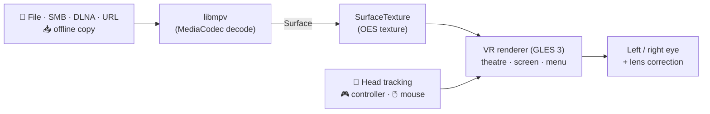

libmpv renders each video frame into an Android `Surface` backed by a `SurfaceTexture`. The VR renderer
draws the procedural theatre (no bitmap or model assets: everything is generated in our own shaders),
places the video on the screen, renders each eye, and corrects for the headset lenses. More detail in
[docs/SPEC.md](docs/SPEC.md).

## Installation

| Where | Status |
|---|---|
| **GitHub Releases** | Beta APK (arm64-v8a and armeabi-v7a) |
| **F-Droid** | Metadata prepared, not submitted yet |
| **NeoStore** | Will follow the F-Droid / IzzyOnDroid listing |

Requirements: Android 7.0 or newer, OpenGL ES 3.0, a gyroscope. A phone VR headset (Cardboard, Daydream
View or similar) for the theatre; without one, use Flat mode.

## Controls

| Input | Action |
|---|---|
| Tap / headset button | Click what the pointer is on; elsewhere show or hide the menu |
| Double-tap | Recenter |
| Long-press | Play / pause |
| Daydream controller | Click = select or play/pause · App = menu · Home = recenter · swipe left/right = seek · drag up/down = resize the screen (pointing at it), dim the lights (pointing above it), else volume |
| Bluetooth mouse | Move = point · click = select · right click = menu · wheel = like the touchpad |
| Space / Enter / A | Play / pause |
| ← / → | Seek −10 s / +10 s |
| ↑ / ↓ | Screen closer / farther |
| `+` / `-` (L1 / R1) | Screen larger / smaller |
| R (Y) · M (X) · V | Recenter · menu · VR / Flat |

## Building from source

The app needs LGPL builds of libmpv and FFmpeg for each ABI; they are not checked into git.

1. On Linux (or WSL), build the native libraries: `tools/build-libmpv.sh` (uses the mpv-android build
   scripts with GPL parts disabled; 30–60 minutes the first time).
2. Copy them into the project: `tools/import-libmpv.sh <mpv-android dir>`.
3. `./gradlew assembleDebug` (JDK 17+ and an Android SDK with NDK r30; set `sdk.dir` in `local.properties`).

Unit tests (no native libraries needed): `./gradlew testDebugUnitTest`.

## FAQ

<details><summary><b>Which phones work?</b></summary>

Tested: ZTE Axon 7 (Android 10). It should work on 64-bit and 32-bit ARM phones with Android 7.0+ and
OpenGL ES 3.0, but that is unverified. Please open an issue with your phone model, Android version and
headset, whether it worked or not.
</details>

<details><summary><b>Does it need the Daydream app or Google VR services?</b></summary>

No. Head tracking, lens correction and the Daydream controller connection are built in. Close the Daydream
app if it grabs the controller first.
</details>

<details><summary><b>Can I use Bluetooth headphones and the controller together?</b></summary>

Yes. Use the Audio tab's Bluetooth preset (+200 ms) and fine-tune the delay in 25 ms steps.
</details>

<details><summary><b>Where are offline copies stored?</b></summary>

In the app's own storage (`Android/data/app.sideviewvr/files/Offline`). No storage permission is needed,
and they are removed when you uninstall the app. Delete them from Library → Offline copies.
</details>

<details><summary><b>Why is Blu-ray support limited?</b></summary>

Only unencrypted ISO files without menus. Ripped MKV files are the better choice: smaller and lighter on the battery.
</details>

## Project layout

```
app/src/main/java/app/sideviewvr/   Kotlin sources (player, renderer, theatre, menu, sources)
app/src/main/jni/                   JNI binding to libmpv
app/src/test/                       Unit tests (subtitle and audio choice)
tools/                              Native build scripts (libmpv, FFmpeg, libbluray; LGPL options)
docs/                               Spec, screenshots, publishing notes
fastlane/                           Store listing (F-Droid / NeoStore metadata)
```

## Contributing

Issues and pull requests are welcome, especially test reports from other phones. Read
[CONTRIBUTING.md](CONTRIBUTING.md) first: the project follows a clean-room rule (no code, assets, names or
protocols from other VR players), and contributions are made under the [CLA](CLA.md).

## License

Sideview VR is free software under the **GNU General Public License v3.0 or later** ([LICENSE](LICENSE)).
libmpv and FFmpeg are built without their GPL-only parts and used as LGPL shared libraries; see
[THIRD_PARTY.md](THIRD_PARTY.md).

Screenshots show *Big Buck Bunny* © 2008 Blender Foundation, [www.bigbuckbunny.org](https://peach.blender.org/),
licensed under [CC BY 3.0](https://creativecommons.org/licenses/by/3.0/).

<p align="center"><i>Sideview VR is an independent project. It is not affiliated with, and contains no code, assets or protocols from, any other VR video player. "Daydream" and "Cardboard" are used only to describe headset compatibility.</i></p>
